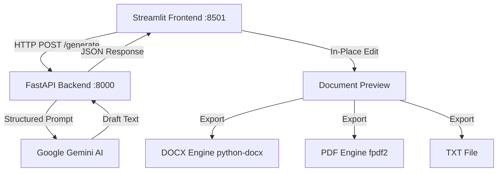

# LegalEase – AI-Powered Legal Document Generator ⚖️

[](https://fastapi.tiangolo.com)
[](https://streamlit.io)
[](https://aistudio.google.com/)
[](https://python.org)
[](LICENSE)

**LegalEase** is a full-stack, enterprise-grade legal-tech web application that generates attorney-level legal document drafts using **Google Gemini AI**. It pairs a high-performance **FastAPI** backend with a modern, responsive **Streamlit** frontend and specialized document formatters for instant **DOCX**, **PDF**, and **TXT** generation.

---

## 📌 Table of Contents
- [Project Overview](#project-overview)
- [Key Features](#key-features)
- [Supported Document Types](#supported-document-types)
- [Architecture & Tech Stack](#architecture--tech-stack)
- [Project Structure](#project-structure)
- [Installation & Environment Setup](#installation--environment-setup)
- [How to Run FastAPI Backend](#how-to-run-fastapi-backend)
- [How to Run Streamlit Frontend](#how-to-run-streamlit-frontend)
- [How to Use the Application](#how-to-use-the-application)
- [Security & Privacy](#security--privacy)
- [Legal Disclaimer](#legal-disclaimer)

---

## 📖 Project Overview

Drafting customized legal instruments—such as non-disclosure agreements, employment contracts, commercial leases, and formal legal notices—often requires significant time and strict adherence to formal legal standards. 

**LegalEase** automates the preliminary drafting process by:
1. Collecting exact transaction variables (document type, parties, dates, covenants, jurisdiction).
2. Feeding structured, anti-hallucination prompts into **Google Gemini**.
3. Returning fully formulated legal documents containing preamble, recitals, definitions, operative covenants, severability, and execution blocks.
4. Offering an **interactive in-place editor** and multi-format exports (**Word DOCX**, **publication-ready PDF**, and **plain TXT**).

---

## 🚀 Key Features

- **🏛️ Modern Legal-Tech UI**: Professional navy blue and slate aesthetic, responsive cards, micro-animations, and clean typography.
- **⚡ 1-Click Template Presets**: Pre-loaded real-world scenarios (NDA, Freelance Contract, Residential Lease, Employment Offer, Legal Notice) for instantaneous testing.
- **🛡️ Strict Factual Fidelity**: Gemini is instructed never to invent user facts; missing standard details use transparent placeholders like `[Insert Address]`.
- **✏️ Interactive Document Editor**: In-place editing before downloading allows users to tailor any clause.
- **📄 Multi-Format Document Export**:
  - **Word DOCX**: Custom styled headers, footers, metadata banners, and signature tables using `python-docx`.
  - **PDF**: Generated via `fpdf2` with LegalEase branding, header rules, confidentiality notices, and page numbering.
  - **Plain TXT**: Clean UTF-8 text formatting.
- **🔌 Resilient Dual Engine**:
  - Full-stack mode via FastAPI `POST /generate`.
  - Seamless standalone fallback mode if running Streamlit independently.
- **🔒 Enterprise Security**: Gemini API keys are kept strictly in `.env` and never exposed to the frontend.

---

## 📑 Supported Document Types

| Document Type | Description |
| :--- | :--- |
| **Agreement** | General mutual covenants between parties |
| **Contract** | Binding commercial terms and considerations |
| **NDA** | Non-Disclosure Agreement for proprietary IP, code, and confidential data |
| **Lease Agreement** | Residential or commercial tenancy covenants and rental terms |
| **Employment Contract** | Full-time/part-time employment obligations, benefits, and salary |
| **Employment Offer Letter** | Formal corporate job offer letter with start dates and equity |
| **Freelance Work Contract** | Independent contractor deliverables, payment milestones, and IP ownership |
| **Legal Notice** | Formal legal demand notice, cure notification, or dispute letter |
| **Affidavit** | Sworn legal statement of truth and oath |

---

## 🛠️ Architecture & Tech Stack



- **Backend**: Python 3.11, [FastAPI](https://fastapi.tiangolo.com/), [Uvicorn](https://www.uvicorn.org/), Pydantic v2
- **Frontend**: [Streamlit](https://streamlit.io/) with custom legal-tech CSS styling
- **AI Core**: [Google Gemini API](https://aistudio.google.com/) (`google-genai` / `google-generativeai`)
- **Document Generation**: `python-docx`, `fpdf2`, `Pillow`
- **Configuration**: `python-dotenv`

---

## 📂 Project Structure

```
LegalEase/
│
├── main.py                     # FastAPI application entrypoint & server setup
├── routes.py                   # FastAPI route definitions (POST /generate, health, exports)
├── app.py                      # Streamlit interactive frontend application
├── requirements.txt            # Python dependencies
├── .env                        # Environment variables (Gemini API key & backend URL)
├── .env.example                # Example environment configuration template
│
├── ai_core/
│   ├── __init__.py
│   └── gemini_generator.py     # Gemini AI prompt engineering & fallback engine
│
├── utils/
│   ├── __init__.py
│   ├── document_formatter.py   # Text sanitization, stats, and markdown parsing
│   ├── docx_generator.py       # Professional Microsoft Word (.docx) generator
│   └── pdf_generator.py        # Publication-ready PDF (.pdf) generator via fpdf2
│
└── assets/
    └── logo.png                # High-resolution LegalEase brand logo
```

---

## 💻 Installation & Environment Setup

### 1. Prerequisites
- Python 3.10, 3.11, or 3.12 installed.
- VS Code or your preferred IDE.

### 2. Clone or Open the Project
Open the project directory in VS Code:
```bash
cd c:\Users\Hari\kokila
```

### 3. Install Dependencies
Install all required packages using pip:
```bash
pip install -r requirements.txt
```

### 4. Configure Environment Variables
Copy `.env.example` to `.env` (if not already created):
```bash
cp .env.example .env
```
Open `.env` and add your **Google Gemini API Key**:
```env
# Get your free Gemini API key from: https://aistudio.google.com/
GEMINI_API_KEY=your_actual_gemini_api_key_here

BACKEND_HOST=127.0.0.1
BACKEND_PORT=8000
BACKEND_URL=http://127.0.0.1:8000
```
> *Note: If you do not have a Gemini API key yet, LegalEase automatically runs its built-in Standard Legal Template Engine so you can test all features and downloads immediately!*

---

## 🚀 How to Run the Project

### Option A: Run Full-Stack (FastAPI + Streamlit)
For the standard full-stack experience, run the backend and frontend in separate terminals:

#### Terminal 1: Start FastAPI Backend
```bash
uvicorn main:app --reload --port 8000
```
Backend will be available at:
- **API URL**: [http://127.0.0.1:8000](http://127.0.0.1:8000)
- **Interactive Swagger Docs**: [http://127.0.0.1:8000/docs](http://127.0.0.1:8000/docs)

#### Terminal 2: Start Streamlit Frontend
```bash
streamlit run app.py
```
Frontend will automatically open in your default browser at:
- **Web UI**: [http://localhost:8501](http://localhost:8501)

---

### Option B: Quick Standalone Mode
If you prefer to run only one command, simply start Streamlit:
```bash
streamlit run app.py
```
LegalEase detects that the backend is standalone and seamlessly routes requests through its internal AI Core engine without any disruption.

---

## 📝 How to Use the Application

1. **Launch the Web App** at `http://localhost:8501`.
2. **Explore the Home Page** to review features and supported document types, then click **"🚀 Start Creating Document"**.
3. **Choose a Document Type** (e.g., *NDA*, *Employment Contract*, *Lease Agreement*).
4. **Fill In Document Details**:
   - **Parties Involved**: Full legal names and addresses.
   - **Effective Date**: Choose from the date picker.
   - **Governing Jurisdiction**: E.g., *State of Delaware* or *California*.
   - **Terms & Conditions**: Describe key clauses, payment, obligations, and term length.
   *(Tip: Use the **⚡ Quick Presets** in the sidebar to auto-populate a realistic example with 1 click!)*
5. **Click "⚡ Generate Document"**: LegalEase invokes the Gemini AI core to construct the draft.
6. **Review & In-Place Edit**:
   - Inspect the formatted legal paper preview.
   - Click **"✏️ Edit Document"** to make live wording adjustments and save them.
7. **Download**:
   - Click **"📄 Download as TXT"** for raw text.
   - Click **"📘 Download as DOCX"** for formatted Microsoft Word file.
   - Click **"📑 Download as PDF"** for publication-ready PDF with page numbering and headers.

---

## 🔒 Security & Privacy

- **No Public API Key Exposure**: All requests to Google Gemini are executed securely server-side.
- **Ephemeral Processing**: Data entered into LegalEase is processed in-memory for document generation and not sold or persisted to tracking databases.
- **CORS Configured**: FastAPI is configured with safe CORS rules for authorized frontend origins.

---

## ⚖️ Legal Disclaimer

> **IMPORTANT:**  
> This document is an AI-generated draft for **informational and productivity purposes only**. It **does not constitute legal advice** and does not create an attorney-client relationship. Laws vary significantly across jurisdictions. Please consult a qualified, licensed legal professional or attorney before executing or relying upon any document generated by this tool.

---

## 👨‍💻 Author & Contributions
Developed with precision for modern corporate and freelance legal-tech needs. Contributions and feature requests are welcome!
